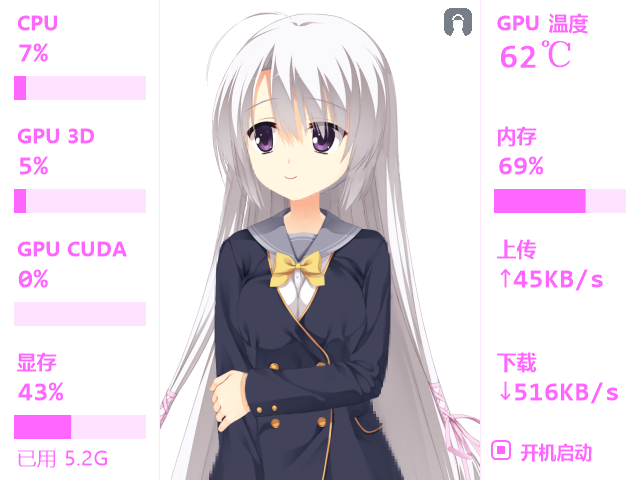
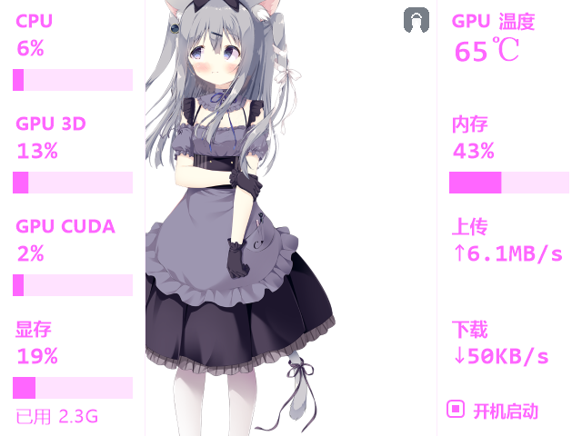

# NeneCubism — 官方 Cubism Native Framework 5-r.5 渲染器 + 迷你屏性能面板

Win32 + WGL + 官方 `CubismRenderer_OpenGLES2` 渲染 `綾地寧々`，替代原先手写的 C# 渲染器。
所有 Live2D 渲染（遮罩/clipping、混合模式、乘算颜色、预乘 alpha）全部由官方 Framework 完成，本工程没有自写渲染管线。

**单一 exe、单一窗口**：在原来的 Live2D 渲染器上整合了原 Python 迷你屏监视器的全部数据采集与
绘制逻辑（C++ / PDH / NVML / GetIfTable2 / GDI+），640×480 窗口内左 160 px 数据面板、
中间 320 px Live2D、右 160 px 数据面板，白底 + 粉色文字（`#FF66FF`）。



*3.5 寸 USB 迷你屏实机截图（640×480）：左侧 CPU / GPU 3D / GPU CUDA / 显存，中间 Live2D 宁宁，右侧 GPU 温度 / 内存 / 网络上下行 / 开机启动。*

## 构建

```powershell
# 注意：若当前 PowerShell 进程里同时存在 NO_PROXY / no_proxy 等大小写重复的环境变量，
# MSBuild 的 ToolTask 会抛出 MSB6001（Hashtable 重复键）。执行前先去掉小写的那一份。
[Environment]::SetEnvironmentVariable('no_proxy',$null,'Process')
[Environment]::SetEnvironmentVariable('http_proxy',$null,'Process')
[Environment]::SetEnvironmentVariable('https_proxy',$null,'Process')

$cmake = 'C:\Program Files (x86)\Microsoft Visual Studio\18\BuildTools\Common7\IDE\CommonExtensions\Microsoft\CMake\CMake\bin\cmake.exe'
& $cmake -S 'E:\测试\CubismApp' -B 'E:\测试\CubismApp\build' -G 'Visual Studio 18 2026' -A x64
& $cmake --build 'E:\测试\CubismApp\build' --config Release --parallel 8
```

产物：

```
E:\测试\CubismApp\build\bin\NeneCubism.exe        （图标资源已嵌入，见 res/app.rc）
E:\测试\CubismApp\build\bin\Live2DCubismCore.dll
E:\测试\CubismApp\build\bin\glew32.dll
E:\测试\CubismApp\build\bin\FrameworkShaders\*.vert *.frag
```

### 独立发布包

`E:\宁宁迷你屏\` 是自包含版本（约 47.8 MB），双击 `NeneCubism.exe` 即可运行：
exe + `Live2DCubismCore.dll` + `glew32.dll` + `FrameworkShaders\` + `model\`（已剔除 `vioce\` 音频）
+ `model.cfg` + `说明.txt`。程序始终按 exe 所在目录解析着色器、模型、日志和 `model.cfg`，
不依赖当前工作目录；模型路径优先级为 `<exeDir>\model\` → 开发目录 `E:\L2D宁宁\...`。

无参数双击时：检测到 640×480 迷你屏（`\\.\DISPLAY30/31`，2560,0）就铺满、不抢焦点；
置顶状态来自托盘右键菜单「置顶显示」的勾选（保存在 `model.cfg` 第 4 个字段），首次运行默认不置顶，
其他应用窗口可以正常覆盖它（`--topmost` 显式指定时优先级最高，覆盖配置文件）。
否则主屏居中显示 640×480。开机自启可直接勾选窗口右下角「开机启动」。

## 运行

```powershell
cd 'E:\测试\CubismApp\build\bin'
.\NeneCubism.exe [x y] [选项]
```

| 参数 | 说明 |
| --- | --- |
| `x y` | 无边框窗口左上角位置（物理像素）；缺省自动放到 640×480 的迷你屏，找不到则主屏居中 |
| `--panels` | 显示左右性能面板（**默认开启**） |
| `--no-panels` | 只看 Live2D，整窗 640×480 都留给模型（旧行为） |
| `--no-tray` | 不创建托盘图标，改用普通任务栏按钮（调试用） |
| `--tray` | 创建托盘图标（默认） |
| `--ui-scale <0.5~3>` | 面板/模型逻辑像素缩放；默认 auto = 目标显示器 DPI（150% → 1.5，640×480 逻辑变成 960×720 物理） |
| `--install-autostart` | 把当前 exe + 当前参数写入 `HKCU\...\Run` 后退出 |
| `--remove-autostart` | 从注册表删除自启项后退出 |
| `--model <dir>` | 模型目录，默认 `E:\L2D宁宁\AYACHI NENE\綾地寧々` |
| `--expression <name>` | 启动时叠加一个表情（名称如 `expression1.exp3`），会关闭默认嘴部微笑 |
| `--idle-breath-only` | 不播放 motion，只用程序呼吸 + 物理 |
| `--physics <on\|off>` | 官方 physics3.json 物理开关，默认 on（off = 只保留 motion 曲线/静止姿势） |
| `--motion <序号\|文件名>` | 选待机动作：`4` = 按文件名排序的第 4 个，或文件名子串；默认选体积最大的（= 完整 待机动作1） |
| `--filter-motion <0\|1>` | 1 = 旧行为，只保留 `ParamHair*`/`ParamBreath` 曲线；默认 0 = 播放完整 motion |
| `--track-blend <0~1>` | 追踪偏移叠加到 motion 上的权重，默认 1.0（0 = 纯 motion，不跟鼠标） |
| `--hair-sway <0~3>` | 静止时手写头发微风幅度，默认 1.0（0 = 完全关闭） |
| `--no-click-motion` | 关闭"点击头部 → 摸头" |
| `--no-click-chest`（别名 `--no-click-shy`） | 关闭"点击胸口 → 0721" |
| `--chest-shy` | 胸口点击改回旧的 3 s 害羞表情 |
| `--idle-stare` | 启用空闲自动"盯"（**默认关闭**）；`--stare-interval-min/-max` 调间隔 |
| `--debug-click/-chest/-stare/-shy <帧>` | 在指定帧触发交互（自动化截图用） |
| `--hit-test <px>,<py>` | 打印该像素（Live2D 中间区域坐标）对应的模型坐标与 head/chest 命中结果后退出 |
| `--track-gain <v>` | 鼠标追踪强度，默认 1.0（追踪始终开启） |
| `--motion-gain <v>` | 统一乘到头/身体摆幅，默认 1.0 |
| `--body-sway <0\|1>` | 极慢待机身体摆动，默认 0（关闭） |
| `--width <n>` / `--height <n>` | 窗口逻辑尺寸，默认 640×480（固定不可缩放） |
| `--hw <v>` | 手动指定相机水平半宽（模型空间）；缺省按中间 320×480 的比例自动计算 |
| `--bg RRGGBB` | 背景纯色，默认 FFFFFF |
| `--topmost` | 窗口置顶；显式指定时优先级最高，覆盖 `model.cfg` 中保存的置顶状态 |
| `--nofocus` | 启动时不抢焦点 |
| `--snapshot <png>` | 渲染若干帧后用 `glReadPixels` 存 PNG（物理窗口内容） |
| `--frames <n>` | 第 n 帧截图，默认 3 |
| `--exit` | 截图后自动退出 |
| `--snapshot-seq "帧:路径;…"` | 按帧定时截图（单进程内多次），会自动关闭 model.cfg 读写 |
| `--track-seq "帧:x,y;…"` | 按帧改变追踪目标（单进程内），用于甩动/惯性序列 |
| `--log-params <N>` | 每 N 帧往日志写一行物理参数（t + 头发/裙摆关键参数） |
| `--dump-params <csv>` | 导出全部参数（Id/Min/Max/Default/Current） |
| `--dump-mesh <csv>` | 导出全部 drawable 顶点（变形后，模型矩阵空间） |
| `--debug-param Id=Value` | 每帧在物理前强制某个参数值（可重复） |
| `--track X,Y` | 固定鼠标追踪目标（归一化 -1~1），用于自动化截图 |
| `--aniso <n>` | 各向异性过滤倍率，默认 16（1=关闭） |
| `--lod-bias <f>` | 纹理 LOD 偏移，默认 -0.5（负数更锐） |
| `--no-mipmap` | 关闭 mipmap（注意：官方 shader 强制 MIPMAP_LINEAR，会变黑，仅诊断用） |
| `--ssaa <f>` | 超采样倍率，默认 2.0（1=关闭） |
| `--size <W>` / `--size <W>x<H>` | 窗口尺寸（单值按 4:3 展开：`--size 640` → 640×480） |
| `--cx --cy --hh` | 相机：中心 x/y 与半高（模型矩阵空间，模型高为 2） |

默认窗口为 **640×480 逻辑像素、无边框、固定尺寸**，自动放置到匹配的迷你屏（`\\.\DISPLAY30/31` 等，
按逻辑分辨率识别）；找不到迷你屏时在主屏居中。窗口不可拖动/缩放（`WM_NCHITTEST` 固定返回 `HTCLIENT`）。
`--snapshot` 会按物理像素保存整窗（150% DPI 下为 960×720）。

默认取景：`centerY = 0.30`、`halfHeight = 0.42`，Live2D 按中间 320×480 区域的比例取景。

按 `ESC` 退出。

### 性能面板（默认开启）

- 布局：左 160 px（CPU / GPU 3D / GPU CUDA / 显存），中间 320 px Live2D，右 160 px
  （GPU 温度 / 内存 / 上传 / 下载）；纯白 `#FFFFFF` 背景，粉色 `#FF66FF` 文字。
  字号：标签/小字 20 px 粗体，数值 27 px 粗体，温度 34 px；进度条 24 px 加粗圆角。
  网络速率 ≥10 KB/s 时省略小数（如 `43KB/s`），保证 160 px 面板内不截断。
- 刷新：每 **1 s** 采样一次，GDI+ 在 32 位 DIB 上重绘后作为 OpenGL 纹理铺到窗口背景，
  中间 320×480 仍由官方 Cubism 渲染器以 SSAA 2x 绘制，两者互不干扰。
- 数据源：
  - CPU：`GetSystemTimes` 差分（全部核心平均）
  - GPU 3D / GPU CUDA：PDH `\GPU Engine(*)\Utilization Percentage`，枚举全部实例，
    分别取 `engtype_3D` / `engtype_Cuda` 的最大值；PDH 不可用时退回 NVML 总利用率
  - 显存 / GPU 温度：NVML（`nvml.dll` 的 `nvmlInit_v2` / `nvmlDeviceGetMemoryInfo` /
    `nvmlDeviceGetTemperature`）；找不到 NVML 时退回解析 `nvidia-smi` 输出
  - 内存：`GlobalMemoryStatusEx`
  - 上传 / 下载：`GetIfTable2`，汇总所有 Up 状态的非 loopback 接口字节数，按时间差分；
    ≥1 MB/s 自动显示 `MB/s`，否则 `KB/s`
  - 任何一项不可用时显示 `--`，不会崩溃
- 右下角 **开机启动** 复选框：直接读写 `HKCU\Software\Microsoft\Windows\CurrentVersion\Run`，
  写入的命令会保留当前启动参数（`--topmost`、`--ui-scale` 等）。
  也可用 `--install-autostart` / `--remove-autostart` 无界面操作。
- 面板开关：`--no-panels` 完全关闭面板与采样，恢复原来的整窗 Live2D。

### 系统托盘（默认开启）

窗口带 `WS_EX_TOOLWINDOW`，**不在任务栏和 Alt+Tab 中出现**；托盘图标由
`Shell_NotifyIcon` + 隐藏的 message-only 窗口（`WM_APP+1` 回调）实现：

- 悬停提示：“宁宁迷你屏” + 当前 CPU / GPU / 温度摘要（每秒随采样更新）。
- 左键单击：显示 / 隐藏窗口；双击：显示窗口。
- 右键菜单：显示/隐藏（勾选）、锁定/解锁模型（勾选）、置顶显示（勾选）、开机启动（勾选）、
  分隔线、退出。
  「置顶显示」切换窗口的 `WS_EX_TOPMOST`：勾选 = `SetWindowPos(HWND_TOPMOST, …,
  SWP_NOMOVE | SWP_NOSIZE | SWP_NOACTIVATE)`，取消 = `HWND_NOTOPMOST`（同样参数）。
  每次打开菜单都用 `GetWindowLongPtrW(GWL_EXSTYLE) & WS_EX_TOPMOST` 刷新勾选状态；
  切换后立即写入 `model.cfg`，退出时再写一次，下次启动恢复；`--topmost` 优先于配置文件。
- 退出时 `NIM_DELETE` 移除托盘图标。
- 置顶验证截图：`shots/tray_menu_topmost_checked.png`（菜单里「置顶显示」已勾选）、
  `shots/topmost_on_notepad_behind.png`（置顶时记事本在迷你屏上盖不住窗口）、
  `shots/topmost_off_notepad_covers.png`（取消置顶后记事本盖住窗口）、
  `shots/restart_topmost_restored.png`（重启后自动恢复置顶）。
- `--no-tray`：不注册托盘图标，窗口改回 `WS_EX_APPWINDOW`（任务栏可见），便于调试。

### 模型编辑锁（右上角按钮）

Live2D 区域（中间 320×480）的右上角有一个 28×28 的圆角按钮，控制**模型**（不是窗口）的交互：

- **灰色 + 锁图标**（默认，锁定）：滚轮和左键拖拽都不起作用，模型保持上次位置/大小。
- **绿色 + 铅笔图标 + 缩放比例**（如 `100%`）：可编辑。
  - **左键拖拽** = 平移模型（相机 cx/cy）。
  - **鼠标滚轮** = 以鼠标位置为中心缩放模型；范围 **50% ~ 300%**。
  - 再次点击按钮回到锁定。

### 保存模型变换

模型的位置和缩放保存到 exe 同目录的 `model.cfg`：

```
cx,cy,hh,topmost
```

例如 `-0.304076,0.406461,0.638767,0`。前三个字段是取景中心 X/Y 与半高；第 4 个字段（`0`/`1`）
是窗口置顶状态，**可选**——只有 3 个字段的旧文件按“不置顶”处理，完全向后兼容。
拖拽结束、滚轮缩放、切换「置顶显示」和退出时写入，下次启动恢复；
`--snapshot` 自动化截图不读取也不写入该文件；`--topmost` 显式指定时优先于文件中的值。

窗口位置/尺寸不保存；每次启动按 640×480 自动放到迷你屏（无则主屏居中），可用命令行参数覆盖。

### 鼠标追踪（始终开启）

每帧用 `GetCursorPos()` 读取全局鼠标位置，换算成相对窗口客户区中心的方向
（`nx = (x - w/2) / (w/2)`，`ny` 同理），并限制在 `[-1, 1]`。

最终参数表（`eyeX/eyeY` 为平滑后的归一化鼠标位置）：

| 参数 | 值 | 作用 |
| --- | --- | --- |
| `ParamEyeBallX` | `0.25 * eyeX` | 眼球轻微跟随 |
| `ParamEyeBallY` | `0.25 * eyeY` | 同上（垂直） |
| `ParamAngleX` | **`15 * eyeX`** | 头部偏航，同时作为头发物理的输入 |
| `ParamAngleY` | `10 * eyeY` | 抬头/低头（脖子支点） |
| `ParamAngleZ` | `0` | 头部不歪（不侧倾） |
| `ParamBodyAngleX` | **`3 * eyeX`** | 肩线/上身轻微跟随，同时驱动裙摆物理 |
| `ParamBodyAngleY` | `0`（强制） | 这个模型上会整体上下平移，禁用 |
| `ParamBodyAngleZ` | `0`（强制） | 禁用：绕腰侧倾 = "整体歪"；motion 里作者给的 ±19° 摇摆也一并压掉 |
| `Param64`（全体 Z） | `0`（强制） | 禁用：全身倾倒 |
| `ParamBreath` | `0.45 + 0.45*sin(2π*0.25t)`（0~0.9，4 s 周期） | 呼吸，也是物理输入 |
| `ParamAngleY` 呼吸分量 | `+1.2*sin(2π*0.25t)` | 吸/呼时脖子轻微点头，让呼吸看得出来 |
| `ParamMouthForm` | `0.7` | 嘴部微笑 |
| `ParamMouthOpenY` | `0`（强制） | 待机 motion 里的张嘴曲线被关掉，嘴保持闭合的微笑 |

**待机动作里被压掉的自动摆动**：完整 `待机动作1` 会自己左右摇——`ParamAngleZ`（头 ±15°）、
`ParamBodyAngleZ`（腰 ±19°）、`ParamBodyAngleY`。这些在每帧 motion 之后被强制清零：
**头不自动左右摇、身体不自动左右摆**，只有鼠标追踪和呼吸/手臂等曲线在动。
`ParamAngleX/Y` 保留 motion 值再叠加追踪偏移（motion 里这两条是 0）。

**呼吸**：motion 里 `ParamBreath` 是常数 0，所以呼吸由程序给：`0.45 ± 0.45`、0.25 Hz（4 s 一次），
并附带 ±1.2° 的 `ParamAngleY` 点头。这个模型胸腔对 `ParamBreath` 的响应本来就小
（0↔1 全身轮廓只差几 px），所以用满 0~0.9 才看得出来。
注意截图间隔：呼吸周期 4 s，**按 2 s 间隔取样会正好落在同一相位**（看起来没在呼吸），
要看呼吸请用 1 s 或 1.3 s 间隔（`motion_breath_0/1/2.png` 就是 1 s 间隔）。

**为什么 `ParamBodyAngleX` 只能给 3**：这个模型的 BodyAngleX 不是干净的偏航，
而是一个分层横向剪切。实测（640×480，鼠标最左/最右）：

| BodyAngleX | 外套水平位移 | 裙子水平位移 | 腰部错位 | 外套下摆左右端 Δy |
| --- | --- | --- | --- | --- |
| ±10（旧值，12 被模型 clamp 到 10） | ±27~30 px | ±25~39 px | 最大 12 px | 最大 13 px |
| ±3 | ±8 px | ±8~13 px | ≤5 px | ≤2 px |

也就是说 `ParamBodyAngleX` 会把外套和裙子以不同幅度横着推走，腰线处出现滑移，
观感是"剪切/整体歪倒"而不是转身。转身主要由头部（`ParamAngleX`）完成，
身体只留 3 度的跟随让肩线有一点点参与。

- **阻尼平滑**：一阶低通，约每帧 0.15 的插值速度。
- 鼠标在窗口外时**继续看向鼠标方向**（超界部分贴边，不会回正）。
- `--track-gain` 调节追踪强度，`--motion-gain` 统一缩放动作幅度。
- `--body-sway 1` 可额外加一个 ±0.75°、0.08 Hz 的极慢待机身体摆动（默认 **关**）。

## 交互（鼠标点击 / 空闲自动动作）

点击判定：`WM_LBUTTONDOWN` 记录位置，`WM_LBUTTONUP` 时位移 **< 6 px** 才算点击；
更大的位移仍然是编辑模式下的平移拖拽（锁定只锁缩放/平移，点击照样生效）。

坐标系：点击像素先按当前相机投影回模型矩阵空间
（`ndc = (2px/W-1, 1-2py/H)`，`model = (cx + ndcx*hw, cy + ndcy*hh)`），
所以缩放/拖拽后命中区域仍然跟着模型走。

| 区域 | 模型坐标 | 触发 |
| --- | --- | --- |
| 头部（含上半头发） | `y > 0.44`（0.44~0.78），`|x| < 0.28` | 播放 `摸头` 一次 + 脸红 |
| 胸口/上身 | `y ∈ [0.10, 0.40]`，`|x| < 0.20` | 播放 `0721` 动作一次（9 s）；`--chest-shy` 时改为旧害羞表情 |
| 其它 | — | 无动作 |

头部优先：头部命中时不再判定胸口（两个区间本身也不重叠）。
胸口点击在**已有动作播放时会被忽略**（日志 `[action] chest ignored (another action is playing)`）。

**动作层**：`摸头` / `0721` / `盯` 各用一条独立 motion，加载时强制 `SetLoop(false)`
（即使文件写 Loop=True 也只播一次）、`SetFadeInTime(0.4)`、`SetFadeOutTime(0.6)`，
由第二个 `CubismMotionManager` 叠在循环待机动作之上（引擎按 fade 权重混合），
播完自动回到待机，不会硬切。`摸头` 4.97 s、`0721` 9.00 s、`盯` 3.47 s。
触发日志：`[action] TRIGGER head-pat (摸头) …` / `[action] TRIGGER chest-0721 …`。

**动作附带脸红**（`摸头` / `0721` 共用同一套 `BeginActionBlush()`，哪个一次性动作在播就给谁）：
`ParamCheek` 从 0 淡入（0.3 s）、保持、在动作结束前 0.4 s 淡出到 0。
`ParamCheek/Cheek5/Cheek6` **每帧都显式写入**（无事件时为 0），
后写覆盖 motion 自带的 `ParamCheek` 曲线，避免动作结束后脸红残留。

**空闲自动"盯"**：默认**关闭**。加 `--idle-stare` 才启用，每 `120~300 s` 随机一次
（`--stare-interval-min/-max`），若正在播别的动作就顺延 2 s。

**旧害羞表情**（`--chest-shy` 时点击胸口启用）：`ParamCheek`（脸红）+ `ParamCheek5`（害羞）
+ `ParamCheek6`（斜线），包络 **0.25 s 淡入 → 2.5 s 保持 → 0.4 s 淡出**，
写在"常驻微笑"之后，不会被 MouthForm 覆盖。

## 物理（官方 physics3.json）

渲染循环现在是最标准顺序，**没有任何手写正弦或角度归零 hack**：

```
LoadParameters
  → 过滤后的待机 motion（只保留 ParamHair*/ParamBreath 曲线）
  → 写入输入参数（追踪角度 / 呼吸 / 微笑 / 眼球）
  → CubismPhysics::Evaluate（physics3.json，52 个 setting）
  → Expression
  → SaveParameters → EyeBlink → model->Update()
```

- `ParamAngleX/Y` 直接作为头发链（`ParamHair*`）的物理输入，转身时头发自然滞后/摆动；
- `ParamBodyAngleX/Y/Z` + `ParamBreath` 驱动裙摆链 `Param13/14/15/65`、`Param16/17/18`、
  `Param33`，以及蝴蝶结/披风/褶皱/手臂等；
- **物理不会输出 `ParamBodyAngle*` / `ParamAngle*` / `Param64`**：已用脚本核对全部
  52 个 setting 的 124 个 Output，`body/angle-ish outputs: []`，所以物理本身不会让身体
  整体倾斜或晃动；
- 静止时物理输出很小（15° 头角下 `ParamHairSideL≈0`、`ParamHairSideL3≈-1°`、
  `ParamHairBackL4≈-5°`），肉眼看到的头发位移主要来自模型骨架（约 15 px @640×480）；
  快速甩动时物理输出会冲到 `ParamHairBackL4≈±27°`、裙摆 `±5~9°`，然后振荡衰减。

开关与调试：

- `--physics off|on`：默认 **on**。`off` 时不调用 `Evaluate`，头发/裙摆只保留 motion 曲线与
  静止姿势，可用于 A/B 对比（此时转身期间头发只跟随骨架，没有惯性）。
- `--log-params <N>`：每 N 帧往日志写一行物理参数（`t=...` + 头发/裙摆关键参数），
  用于验证物理是否真的在动。
- `--track-seq "帧:x,y;帧:x,y"` + `--snapshot-seq "帧:路径;帧:路径"`：
  在**同一个进程**里按帧改鼠标目标并定时截图，用来拍"甩动"序列（惯性是时间相关的，
  单独 `--track` 每次都是新进程，拍不到）。

## 渲染清晰度（纹理 / 超采样）

8192×8192 贴图在 640×480~900×675 窗口里实际只显示到原分辨率的 ~1/7，
官方 `CubismShader_OpenGLES2::SetupTexture()` 每次绘制都会把采样状态固定成
`GL_LINEAR_MIPMAP_LINEAR` + `GL_LINEAR` + `GL_REPEAT`（在 SDK 里写死，见
`Framework/src/Rendering/OpenGL/CubismShader_OpenGLES2.cpp:1099`），
所以能调的只有 `GL_TEXTURE_LOD_BIAS` 和 `GL_TEXTURE_MAX_ANISOTROPY_EXT`。
当前设置：

- `GL_TEXTURE_MAG_FILTER = GL_LINEAR`
- `GL_TEXTURE_MIN_FILTER = GL_LINEAR_MIPMAP_LINEAR`（生成完整 mipmap 链）
- `GL_TEXTURE_LOD_BIAS = -0.5`：把三线性选到的 mip 往清晰一侧偏半级
- 各向异性过滤 **16x**（`GL_EXT_texture_filter_anisotropic`，驱动支持时）
- 内部格式保持 **RGBA8**，不做 sRGB 解码：shader 直接输出到非 sRGB 默认帧缓冲，
  改成 `GL_SRGB8_ALPHA8` 会多一次解码而没有对应编码，导致中间调整体变暗。
- **SSAA 2x**：模型整帧渲染到 2 倍尺寸 FBO（900×675 → 1800×1350），
  再用一次双线性采样（正好是 2×2 box）缩到窗口。这同时解决
  ① 贴图细节被裁掉（等效 mip 再清晰一级）② 网格/裁剪边缘的锯齿。
  UI（右上角按钮、百分比）在 resolve 之后按窗口分辨率绘制，保持锐利。

实测同一区域（640×480，腰部/外套 150×100）梯度能量：修改前 9.40 → 修改后 10.94（+16%），
边缘阶梯明显减少。`--ssaa 1 --aniso 1 --lod-bias 0` 可复现修改前的观感。

## 待机行为（默认）

- **motion 只保留头发/呼吸曲线**：168 条曲线在内存中过滤成 50 条（全部 `ParamHair*` + `ParamBreath`），
  `ParamAngle*`、`ParamBodyAngle*`、`Param1~79`、手臂、嘴、眼等曲线全部丢弃。
  其中 `ParamHair*` 这些曲线随后会被物理输出覆盖（官方流程本来如此），
  所以静止时的头发姿势 = 物理收敛姿势；`--physics off` 时则完全由这些曲线决定。
- **头发/裙摆由物理驱动**：转身、抬头、呼吸都会进 physics3.json，
  头发链和裙摆链自然滞后、回摆；**没有**任何手写正弦。
- **微微呼吸**：每帧 `ParamBreath = 0.15 + 0.15 * sin(2π * 0.25 * t)`，即 0~0.3、0.25 Hz。
- **常驻微笑（只动嘴形，不张嘴）**：每帧 `ParamMouthForm = 0.7`、`ParamMouthOpenY = 0`；
  待机 motion 自带的张嘴曲线被压掉（否则看起来在说话）。不设置 `ParamEyeLSmile` /
  `ParamEyeRSmile`（强制为 0），眼睛保持正常睁开，眨眼仍由 Framework EyeBlink 处理。
- `--idle-breath-only` 时不播放 motion，其余行为相同。

### expression/*.exp3.json 分析

5 个表情每个都只包含 27 条 `ParamCheek*` 参数（Add，值 -1/0/1），**没有任何
`ParamMouthForm`、`ParamMouthOpenY`、`ParamEye*Smile` 或眼睛参数**，实际上是换装/参数开关，
不是微笑表情。因此默认不使用 exp3，直接用 `ParamMouthForm = 0.7` 实现嘴部微笑；
`--expression` 仍可用于手动叠加这些开关，但每帧会把 EyeSmile 归零以保持正常睁眼。

## 验证截图

### 交互验证

- `shots\click_0_idle.png` / `click_1.png` / `click_2.png` / `click_3_back.png` — 点击头部后的摸头动作（触发前 / 0.5 s / 2 s / 恢复后）
- `shots\pat_0_before.png` / `pat_1.png` / `pat_2.png` / `pat_3_back.png` + `pat_blush_sequence.png` — 摸头 + 脸红（脸部特写）
- `shots\chest_0_before.png` / `chest_1.png` / `chest_2.png` / `chest_3_back.png` + `chest_sequence.png` — 点击胸口播放 `0721`
- `shots\chest_blush_0_before.png` / `chest_blush_1_3s.png` / `chest_blush_2_95s.png` + `chest_blush_sequence.png` — `0721` + 脸红（触发前 / 3 s / 9.5 s 恢复）
- `shots\shy_0_before.png` / `shy_1_after05.png` / `shy_2.png` / `shy_3_back.png` — 点击胸口：触发前 / 0.5 s / 保持中 / 恢复后
- `shots\shy_sequence.png` — 上面四张脸部特写并排
- `shots\chk_sheet.png` — 单参数对比：base / 脸红(ParamCheek) / 害羞(ParamCheek5) / 半眯(ParamCheek10) / 眯眼(ParamCheek11) / 斜线(ParamCheek6)
- `shots\shy_sheet.png` — 组合对比：脸红+害羞 / +斜线 / +眯眼
- `shots\stare_0_idle.png` / `stare_1.png` / `stare_2_mid.png` / `stare_3_back.png` + `stare_sequence.png` — 空闲"盯"动作（待机 / 触发中 / 保持 / 恢复）

命令示例：

```powershell
# 点胸口：0.25s 淡入 + 2.5s 保持 + 0.4s 淡出
.\NeneCubism.exe --width 640 --height 480 --frames 350 --exit --track 0,0 --debug-shy 60 `
  --snapshot-seq "30:shots\shy_0_before.png;90:shots\shy_1_after05.png;200:shots\shy_2.png;330:shots\shy_3_back.png"
```

### 完整待机动作 + 呼吸 + 物理（当前默认）

- `shots\motion_idle_0.png` / `_1.png` / `_2.png` — 静止，间隔 2 s（展示 motion 的手臂/手部微动；
  呼吸是 4 s 周期，2 s 间隔正好同相位）
- `shots\motion_breath_0.png` / `_1.png` / `_2.png` — 静止，间隔 **1 s**（吸→中→呼，能看出呼吸）
- `shots\motion_idle_strip.png` / `motion_breath_strip.png` — 上面两组并排
- `shots\motion_flick_0_rest.png` → `_1.png`（甩动中）→ `_2.png` → `_3_back.png` — 甩动 / 惯性
- `shots\motion_flick_strip.png` — 甩动四帧并排
- `shots\breath_hi_lo.png` / `breath_detail.png` — 呼吸幅度 0.9 vs 0.0 的对比（放大）

静止/甩动截图命令：

```powershell
.\NeneCubism.exe --width 640 --height 480 --frames 200 --exit --track 0,0 `
  --snapshot-seq "60:shots\motion_breath_0.png;120:shots\motion_breath_1.png;180:shots\motion_breath_2.png"

.\NeneCubism.exe --width 640 --height 480 --frames 310 --exit `
  --track-seq "0:0,0;110:-1,0;140:1,0;220:0,0" `
  --snapshot-seq "100:shots\motion_flick_0_rest.png;160:shots\motion_flick_1.png;178:shots\motion_flick_2.png;300:shots\motion_flick_3_back.png"
```

### 物理版（上一轮）

- `shots\phys_left.png` / `phys_center.png` / `phys_right.png` — 640×480，鼠标最左/中/最右（physics on）
- `shots\phys_off_left.png` / `phys_off_center.png` / `phys_off_right.png` — 同样位置，`--physics off` 对比
- `shots\phys_swing_0_rest.png` — 甩动序列：静止
- `shots\phys_swing_1_flick.png` — 刚甩到最右（第 152 帧）
- `shots\phys_swing_2_after03.png` — 甩后 0.3 s（第 170 帧）
- `shots\phys_swing_3_back.png` — 回到中间后（第 290 帧）
- `shots\phys_off_swing_*.png` — 同序列的 `--physics off` 版本
- `shots\swing_compare.png` / `shots\phys_swing_detail.png` — 上面两组对比

甩动序列命令（单进程、按帧改鼠标目标）：

```powershell
.\NeneCubism.exe --width 640 --height 480 --frames 300 --exit `
  --track-seq "0:0,0;110:-1,0;140:1,0;220:0,0" `
  --snapshot-seq "100:shots\phys_swing_0_rest.png;152:shots\phys_swing_1_flick.png;170:shots\phys_swing_2_after03.png;290:shots\phys_swing_3_back.png"
```

### 之前的取景/清晰度验证

- `shots\skew_left.png` / `skew_center.png` / `skew_right.png` — 鼠标最左/中/最右（640×480）
- `shots\before_left.png` / `before_center.png` / `before_right.png` — 修复前参数复现（用 `--debug-param` 还原 `ParamAngleX=±12`、`ParamBodyAngleX=±10`）
- `shots\skew_fix_compare.png` — 修复前/后躯干 2 倍对比
- `shots\blur_before.png` / `blur_after.png` — 腰部/外套同区域 4 倍：无 aniso/LOD 0/无 SSAA vs aniso16/LOD -0.5/SSAA 2x
- `shots\blur_compare.png` — 上面两张并排
- `shots\metrics.json` — 下摆端点、躯干平移、腰部错位的测量原始数据

下摆测量方法：金色下摆滚边的像素（`r-b>55, g-b>25`）逐列取最下方一点，
取最左/最右连续段的 y 中位数。修复前最差 13 px（左端外扩时），修复后 ≤2 px。
- `build\bin\final_idle_t1.png` / `t2` / `t3.png` — 默认待机，间隔约 2 秒（第 90/210/330 帧）
- `build\bin\final_face_smile.png` — 脸部特写：嘴角上扬、正常睁眼、单个嘴、无虚影
- `build\bin\final_breath_t1.png` / `t2` / `t3.png` — `--idle-breath-only` 对比
- `build\bin\final_center.png` — 鼠标中心（新幅度）
- `build\bin\final_left.png` — 鼠标最左
- `build\bin\final_right.png` — 鼠标最右
- `build\bin\final_up.png` — 鼠标最上
- `build\bin\final_down.png` — 鼠标最下
- `build\bin\track_center.png` — 鼠标在窗口中心（旧幅度对比）
- `build\bin\track_inside.png` — 鼠标在窗口内左侧
- `build\bin\track_outside_left.png` — 鼠标在窗口外左侧（继续看左）
- `build\bin\track_outside_right.png` — 鼠标在窗口外右侧（继续看右）
- `build\bin\fullscreen_default_locked.png` — 默认全屏、锁定状态（2560×1600）
- `build\bin\zoom_100_edit.png` — 编辑模式 100%
- `build\bin\zoom_in_edit.png` — 滚轮放大（152%）
- `build\bin\zoom_out_edit.png` — 滚轮缩小（66%）
- `build\bin\zoom_pan_edit.png` — 拖拽平移后
- `build\bin\zoom_locked.png` — 锁定状态（灰色锁按钮）
- `build\bin\zoom_restored_locked.png` — 重启后恢复位置/缩放并保持锁定
- `build\bin\shot_full.png` — 全身体构图参考

## 实现要点

- `CubismFramework::StartUp(&allocator, &option)`：`option.LoadFileFunction` 负责按 UTF-8 路径读文件，
  同时供 Framework 读取 `FrameworkShaders/…` 的 shader 源文件。
- `CubismUserModel` 子类：`LoadModel` → `CreateRenderer(640,480)` → 官方
  `CubismRenderer_OpenGLES2::BindTexture` → `IsPremultipliedAlpha(false)`。
- 每帧顺序：`LoadParameters` → 过滤后的 motion（仅头发/呼吸曲线）→ 写入输入参数
  （追踪角度、呼吸、微笑、眼睛）→ `CubismPhysics::Evaluate` → expression → `SaveParameters`
  → `CubismEyeBlink::UpdateParameters` → `model->Update()` → 官方 renderer 绘制。
  没有角度归零、没有手写正弦。
- motion 过滤是在读取 `待机动作1.motion3.json` 后、交给 `LoadMotion` 前，对 `"Curves"` 数组做
  字符串级裁切（保留 `ParamHair*`、`ParamBreath`），不改原文件。
- 渲染器 5-r.5 的 clipping 走 FBO offscreen（仍按需求申请了 `cStencilBits = 8` 的像素格式）。
- 纹理：`stb_image` 从内存解码 8192×8192 PNG，生成完整 mipmap 链，RGBA8，
  LOD bias -0.5 + 16x 各向异性；模型整帧经 2x 超采样 FBO 再缩回窗口（见上文）。
- 未改 `ParamCheek*` 等换装参数；默认只显示校服 + 长发。

## 踩过的坑

1. **MSB6001 `NO_PROXY`/`no_proxy` 重复键**：VS 18 BuildTools 的 MSBuild 在构造工具进程环境时
   把环境变量放进大小写不敏感的 Hashtable，Windows 环境里同时存在大小写两份代理变量就崩。
   删掉小写的 `no_proxy` / `http_proxy` / `https_proxy` 后 CMake 配置和编译都正常。
2. **GLEW 需要单独下载**：SDK 的 `Samples\OpenGL\thirdParty` 只有下载脚本，没有 GLEW/GLFW。
   本工程使用 GLEW 2.2.0 的 x64 DLL 版本（静态库 `glew32s.lib` 与 /MD 运行库冲突，会报 LNK4098），
   并复制 `glew32.dll` 到 exe 旁。
3. **5-r.5 渲染器 API 变化**：`CubismRenderer_OpenGLES2` 把 clipping 放到
   `CubismOffscreenManager_OpenGLES2` 管理，必须每帧 `BeginFrameProcess`/`EndFrameProcess`，
   否则遮罩相关行为不完整。
4. **Shader 从磁盘加载**：`CubismShader_OpenGLES2` 通过 Framework 的 LoadFileFunction 读取
   `FrameworkShaders/…`，必须把 SDK 的 `Shaders/Standard` 目录原样拷到 exe 旁。
5. **日志文件**：最初用 `_wfopen(..., L"w, ccs=UTF-8")` 写日志会在启动时崩溃（0xC0000409），
   改为 `CreateFileW` + `WriteFile` 追加写后稳定。
6. **DPI**：exe 调用 `SetProcessDPIAware()`；PowerShell 截屏脚本也需要 `SetProcessDPIAware()`，
   否则 `GetWindowRect` 返回的是 150% 缩放后的 427×320 逻辑坐标。


---

## ⚠️ 适用范围（重要）

本项目是**为特定分辨率的 USB 小屏定制的**：

- 目标设备：**3.5 寸 USB 迷你屏**，物理分辨率 320×240，驱动下设置为 **640×480**
- 程序按 **640×480** 设计三栏布局（左 160px 数据 / 中 320px Live2D / 右 160px 数据）
- 启动时会自动寻找 **640×480 的显示器**并铺满；找不到则在主屏居中显示 640×480 窗口
- **不保证适配其他分辨率/尺寸的屏幕**：窗口比例、字号、面板宽度都是按 640×480 写死的

如果你的屏幕不是 640×480，需要自行调整：
- `src/PanelRenderer.cpp` 里的面板宽度（160）、字号、行距
- `src/main.cpp` 里的 viewport（160..480）和窗口尺寸

## 📦 开箱即用的发布包

在 [Releases](https://github.com/AyachiNeneCiallo/NeneCubismMiniScreen/releases) 页面下载 `NeneCubismMiniScreen.zip`，解压后**双击 `NeneCubism.exe`** 即可运行（已包含模型、着色器、依赖 DLL，无需编译）。

包内结构：
```
NeneCubism.exe          主程序，双击运行
Live2DCubismCore.dll    Cubism Core
glew32.dll              OpenGL 加载器
FrameworkShaders\       官方渲染着色器（22 个）
model\                  模型目录（可替换，见下）
model.cfg               人物位置/缩放记忆
说明.txt                使用说明
```

## 🔄 如何更换模型

程序支持任意 **Cubism 3/4/5 的 `.moc3` 模型**，只需替换 `model\` 目录内容，**不需要重新编译**。

### 步骤

1. **准备模型文件夹**（从 Live2DViewerEX / VTube Studio 模型包里解出的 `runtime` 目录就是这种结构）：

   ```
   新模型文件夹\
   ├── xxx.model3.json        ← 必需：模型配置
   ├── xxx.moc3               ← 必需：模型数据
   ├── xxx.8192\              ← 必需：贴图目录
   │   └── texture_00.png
   ├── xxx.physics3.json      ← 可选：物理（没有则头发/裙摆不会摆动）
   ├── motion\*.motion3.json   ← 可选：动作（没有则人物静止不动）
   └── expression\*.exp3.json  ← 可选：表情
   ```

2. **备份原模型**（方便回滚）：
   ```powershell
   Rename-Item 'E:\宁宁迷你屏\model' 'model_backup'
   ```

3. **放入新模型**：
   ```powershell
   New-Item -ItemType Directory -Path 'E:\宁宁迷你屏\model'
   Copy-Item '你的新模型目录\*' 'E:\宁宁迷你屏\model\' -Recurse -Force
   ```

4. **删除 `model.cfg`**（**这一步必做**，原因见下）：
   ```powershell
   Remove-Item 'E:\宁宁迷你屏\model.cfg'
   ```

5. **双击 `NeneCubism.exe` 运行**，然后调整构图：
   - 点右上角**铅笔按钮**解锁（变绿色，显示缩放百分比）
   - **滚轮**缩放（50%~300%），**左键拖拽**平移
   - 点按钮**锁定**，配置自动写入 `model.cfg`，下次启动沿用

### ⚠️ 为什么必须删 model.cfg

`model.cfg` 存的是 `cx,cy,hh[,topmost]`（取景中心 X/Y + 半高，可选的置顶状态），
其中取景部分**绑定的是上一个模型的画布尺寸**。

不同模型的画布差异很大：

| 模型 | 画布（model3.json 里没有，看 `[model] canvas` 日志） |
|------|------------------------------------------------|
| 綾地寧々（宁宁） | 约 2.50 × 5.00 |
| 千绘莉 | 1.00 × 2.10 |

沿用旧参数会直接导致**只看到半张脸**或**人物缩成一个小点**。删除后程序会用默认 `0,0.30,0.42`，再用滚轮/拖拽微调即可。

### 换模型后的能力差异（重要）

| 模型自带内容 | 换过去之后的表现 |
|-------------|----------------|
| 有 `physics3.json` | 头发/裙摆随动作惯性摆动 |
| **没有** `physics3.json` | 头发完全不动 |
| 有 `motion\` 动作文件 | 待机动作循环播放（自动选最大的那个 motion） |
| **没有** `motion\` 目录 | **人物完全静止**（不呼吸、不微动），只有鼠标追踪还能动头 |
| 有 `expression\` 表情 | 加载备用（本项目当前默认不叠加表情） |

> 实测千绘莉模型（`E:\L2D千绘莉模型\qianhuili1.4`）只有 moc3 + 贴图 + physics，**没有 motion 目录**，所以换过去后待机是静止的，只有头发物理还在。



*换上千绘莉模型后的实机画面（画布 1.00×2.10，取景 `0,0.02,1.15`）。*

### 参数名兼容性

交互功能对参数名有硬编码依赖，**标准命名的模型才完整可用**：

| 功能 | 依赖参数 | 不兼容时 |
|------|---------|---------|
| 视线追踪 | `ParamAngleX/Y`、`ParamEyeBallX/Y` | 头不转、眼不动 |
| 摸头/0721 脸红 | `ParamCheek` | 没脸红 |
| 常驻微笑 | `ParamMouthForm` | 嘴形不变 |
| 呼吸 | `ParamBreath` | 无呼吸起伏 |
| 头发物理 | `ParamHair*`（physics3.json 输出） | 头发不摆 |

**待机显示、性能面板、缩放拖拽始终正常**，只是交互可能部分失效。

### 程序如何识别模型文件

| 项目 | 规则 |
|------|------|
| 配置文件 | 扫描 `model\` 下第一个 `*.model3.json`，**跳过 `Live2DViewerEX.model3.json`** |
| 贴图 | 按 model3.json 里 `FileReferences.Textures` 的路径加载 |
| 待机动作 | 自动选 `motion\` 里**体积最大**的 `.motion3.json` 循环播放 |
| 语音目录 | 模型自带 `vioce\` 不会被使用（本项目无语音），可删除省空间 |
| 模型目录优先级 | `<exe目录>\model\` 存在就用它；不存在才回退开发路径 `E:\L2D宁宁\...` |

### 常见问题

| 现象 | 原因 / 解决 |
|------|------------|
| 只看到半张脸 / 人物巨大 | 忘了删 `model.cfg` |
| 人物很小 / 偏在角落 | 同上；解锁后滚轮+拖拽调好再锁定 |
| 贴图全黑 / 花掉 | model3.json 里贴图路径与实际目录不符 |
| 人物完全不显示 | 目录里有多份 `*.model3.json` 被取错了；或 moc3 版本过新 |
| 启动直接崩溃 | 模型版本不兼容，换 Cubism 3/4 的模型试试 |
| 人物完全静止不动 | 模型没有 `motion\` 目录，属正常现象 |
| 头发不摆动 | 模型没有 `physics3.json` |

### 回滚到原模型

```powershell
Remove-Item 'E:\宁宁迷你屏\model' -Recurse -Force
Rename-Item 'E:\宁宁迷你屏\model_backup' 'model'
Set-Content 'E:\宁宁迷你屏\model.cfg' '0.001503,0.423355,0.276157'   # 宁宁的取景参数
```

## 🛠️ 从源码构建

### 依赖

| 依赖 | 版本 | 获取方式 |
|------|------|---------|
| Visual Studio Build Tools | 2019/2022/2026 | https://visualstudio.microsoft.com/downloads/ |
| CMake | 3.20+ | VS 自带或 https://cmake.org/ |
| **Cubism SDK for Native** | **5-r.5** | https://www.live2d.com/download/cubism-sdk/ （需同意协议） |
| GLEW | 2.2.0 (x64 DLL 版) | https://glew.sourceforge.net/ |
| 模型文件 | 自备 | 见上文"如何更换模型" |

### 放置第三方库

```
E:\测试\CubismApp\
├── CMakeLists.txt
├── src\
└── third_party\
    └── glew-2.2.0\
        ├── include\GL\...
        ├── lib\Release\x64\glew32.lib
        └── bin\Release\x64\glew32.dll
```

`sdk` 路径在 `CMakeLists.txt` 顶部修改：
```cmake
set(SDK_ROOT "E:/测试/CubismSdk/CubismSdkForNative-5-r.5")
```

#

*3.5 寸 USB 迷你屏实机截图（640×480）：左侧 CPU / GPU 3D / GPU CUDA / 显存，中间 Live2D 宁宁，右侧 GPU 温度 / 内存 / 网络上下行 / 开机启动。*

## 构建命令

```powershell
# 关键：Windows 上同时存在 NO_PROXY/no_proxy 会让 VS 的 MSBuild 崩（MSB6001）
[Environment]::SetEnvironmentVariable('no_proxy',$null,'Process')
[Environment]::SetEnvironmentVariable('http_proxy',$null,'Process')
[Environment]::SetEnvironmentVariable('https_proxy',$null,'Process')

$cmake = 'C:\Program Files (x86)\Microsoft Visual Studio\18\BuildTools\Common7\IDE\CommonExtensions\Microsoft\CMake\CMake\bin\cmake.exe'
& $cmake -S . -B build -G "Visual Studio 18 2026" -A x64
& $cmake --build build --config Release --parallel 8
```

产物：`build\bin\NeneCubism.exe`

### 部署

把以下文件放到同一目录：

```
NeneCubism.exe
Live2DCubismCore.dll          ← 从 SDK 的 Core\dll\windows\x86_64\ 拷贝
glew32.dll                    ← 从 GLEW 的 bin\Release\x64\ 拷贝
FrameworkShaders\             ← 从 SDK 的 Framework\src\Rendering\OpenGL\Shaders\ 拷贝
model\                        ← 你自己的模型
```

## 🎮 使用说明

| 操作 | 效果 |
|------|------|
| 鼠标移动 | 视线跟随（转头/抬头，身体不晃） |
| 点击**头部** | 摸头动作 + 脸红 |
| 点击**胸口** | 0721 动作 + 脸红 |
| 滚轮 | 缩放人物 50%~300%（以鼠标位置为中心） |
| 左键拖拽 | 平移人物 |
| 右上角按钮 | 绿色=可编辑（显示缩放比例）/ 灰色=锁定 |
| 右下角复选框 | 开机自启开关 |
| 托盘图标 左键 | 显示/隐藏窗口 |
| 托盘图标 右键 | 显示/隐藏、锁定、置顶显示、开机启动、退出 |

### 命令行参数

```
--panels / --no-panels       显示/隐藏数据面板（默认显示）
--width <w> --height <h>     自定义窗口尺寸（默认自动检测 640x480 显示器）
--cx --cy --hh               手动指定取景中心和半高
--motion <序号|名称>          切换待机动作
--track-gain <0~3>           视线追踪强度
--motion-gain <0~3>          动作幅度倍率
--hair-sway <0~3>            头发静止轻摆幅度
--physics on/off             是否启用模型自带物理
--ssaa <倍数>                超采样倍数（默认 2）
--topmost / --nofocus        置顶（覆盖 model.cfg 里的置顶状态）/ 不抢焦点
--no-tray                    不创建托盘图标（恢复任务栏按钮，调试用）
--install-autostart          写入开机自启
--remove-autostart           移除开机自启
--snapshot <png> --exit      截图后退出（调试用）
```

## 📊 资源占用（实测）

| 指标 | 数值 |
|------|------|
| 工作集内存 | ~152 MB |
| CPU（任务管理器口径，32 核） | 0.39% 平均 / 0.85% 峰值 |
| GPU 3D 引擎 | ~1.7% |
| 帧率 | ~60 fps |
| 线程数 | 9 |

## ⚖️ 版权说明

- **代码**：本仓库的源代码可自由使用、修改
- **模型**：宁宁（綾地寧々）模型版权归原作者/游戏公司所有，**不在本仓库分发**，发布包中的模型仅供本地使用，请勿再分发
- **Cubism SDK**：Live2D Cubism SDK 遵循 [Live2D 专有许可](https://www.live2d.com/eula/live2d-proprietary-software-license-agreement_cn.html)

